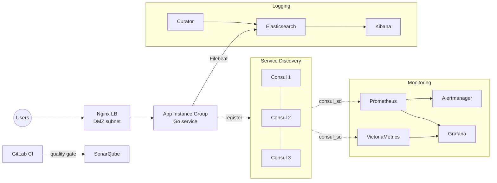
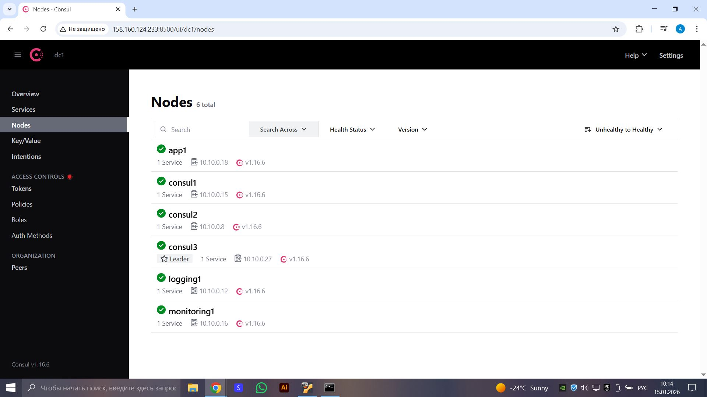
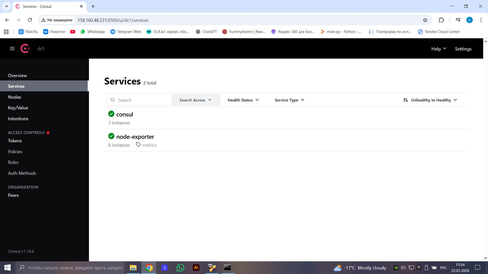
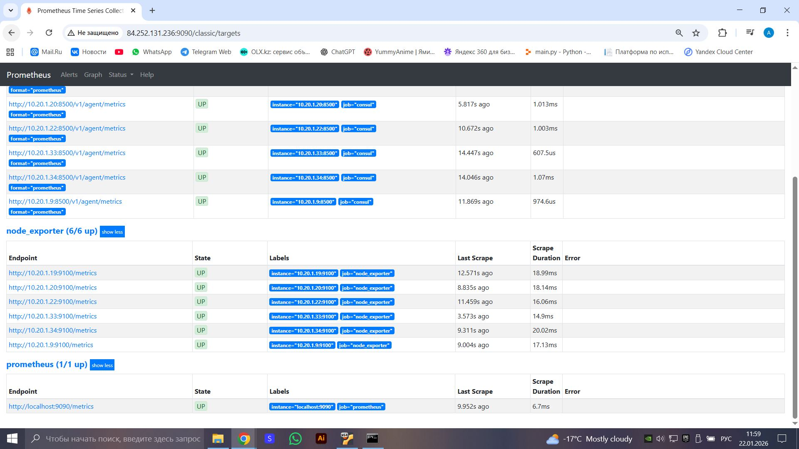
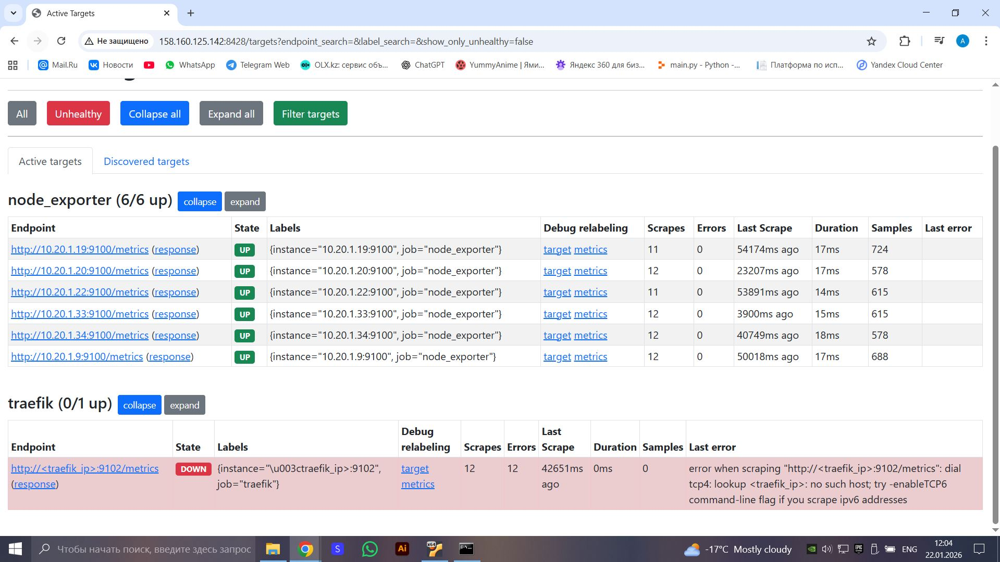
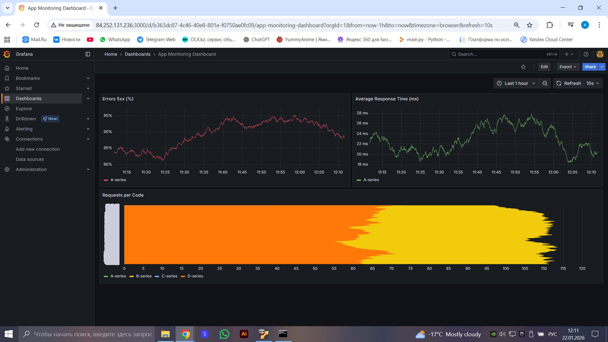
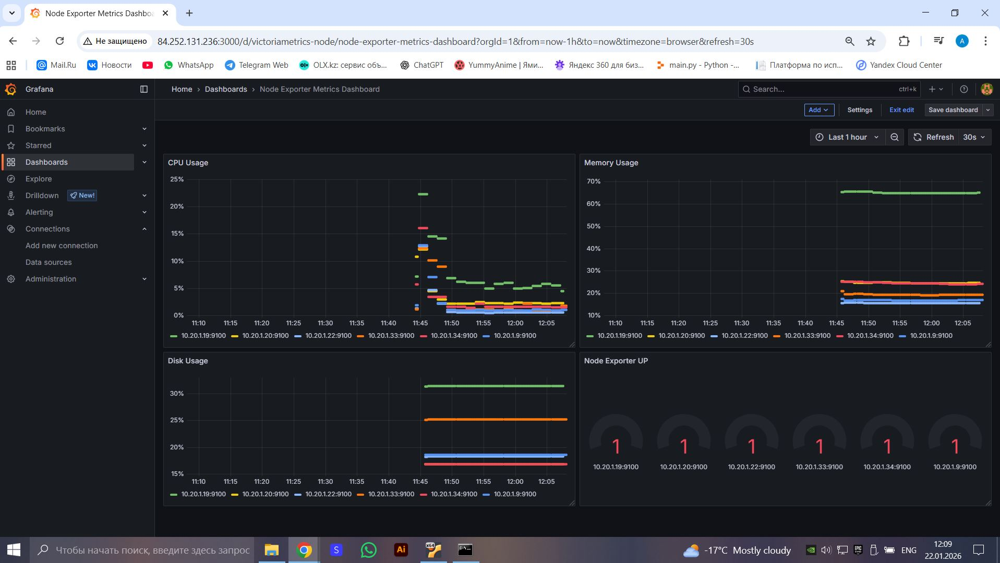
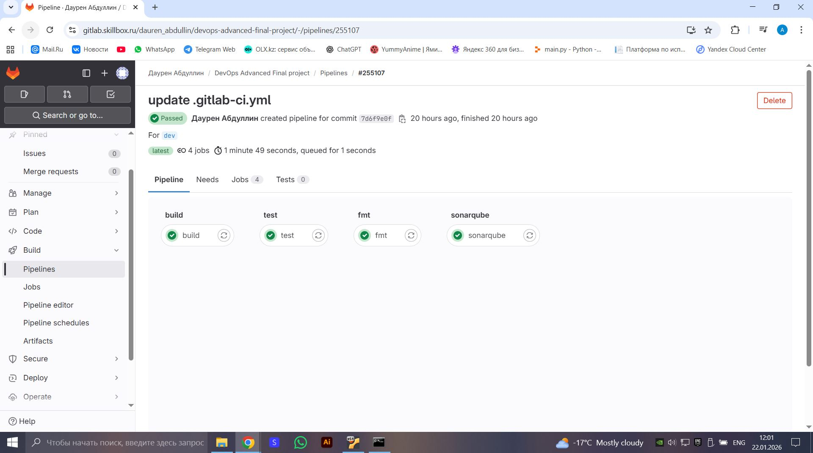
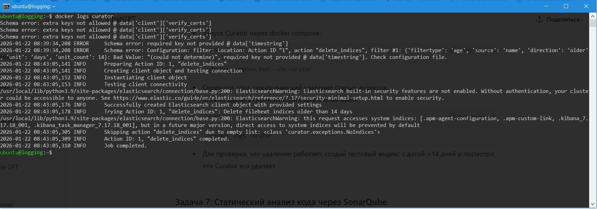

# DevOps Infrastructure Platform (Yandex Cloud)

> Infrastructure-as-Code platform for a Go microservice: Terraform + Ansible on Yandex Cloud with service discovery, monitoring, centralized logging, static analysis and CI/CD.

Инфраструктурная платформа для микросервиса на Go, полностью описанная кодом: от сети и виртуальных машин до мониторинга, логирования и CI/CD.

## Стек

| Область | Инструменты |
|---|---|
| IaC | Terraform (Yandex Cloud provider), Ansible (12 ролей) |
| Service Discovery | Consul — кластер из 3 серверов + агенты на всех нодах, KV для версии релиза |
| Мониторинг | Prometheus, Node Exporter, VictoriaMetrics, Grafana (USE/RED дашборды), Alertmanager |
| Логирование | EFK: Elasticsearch, Filebeat, Kibana, Curator (ротация индексов) |
| CI/CD | GitLab CI: build → test → fmt → SonarQube quality gate |
| Качество кода | SonarQube |
| Сеть / безопасность | VPC с сегментацией (DMZ / app / db подсети), Security Groups |
| Балансировка | Nginx в DMZ, Yandex Instance Group для инстансов приложения |
| Контейнеры | Docker, Docker Compose, multi-stage Dockerfile |

## Архитектура



Prometheus и VictoriaMetrics находят цели через Consul service discovery, поэтому новые инстансы приложения попадают в мониторинг автоматически, без правки конфигов.

## Структура репозитория

```
infra/
├── terraform/            # VPC, подсети, Security Groups, ВМ, Instance Group
│   ├── main.tf           # ВМ + генерация Ansible inventory
│   ├── security.tf       # подсети и Security Groups
│   ├── variables.tf
│   └── terraform.tfvars.example
└── ansible/
    ├── playbook.yml
    ├── inventory.example.yml   # реальный inventory генерирует Terraform
    └── roles/
        ├── docker/  consul/  consul_client/  node_exporter/
        ├── prometheus/  grafana/  alertmanager/  victoriametrics/
        ├── efk/  filebeat/
        ├── sonarqube/
        └── lb/
service/                  # Go-микросервис + GitLab CI
docs/
├── screenshots/
└── budget-and-roadmap.xlsx   # расчёт стоимости инфраструктуры и план развития
```

## Развёртывание

### 1. Terraform

```bash
cd infra/terraform
cp terraform.tfvars.example terraform.tfvars   # заполнить cloud_id, folder_id, ключ SA
terraform init
terraform apply
```

Создаются VPC, подсети, Security Groups, ВМ (Consul ×3, monitoring, logging, VictoriaMetrics, SonarQube, LB) и Instance Group приложения. Terraform сам формирует `infra/ansible/inventory.yml`.

### 2. Ansible

```bash
cd infra/ansible
ansible-playbook -i inventory.yml playbook.yml
```

Плейбук ставит Docker, поднимает кластер Consul, регистрирует сервисы, разворачивает мониторинг, EFK, SonarQube и балансировщик.

### 3. CI/CD

Пайплайн в `service/.gitlab-ci.yml`: `build → test → fmt → sonarqube`.
В настройках GitLab нужно задать переменные `SONAR_TOKEN` и `SONAR_HOST_URL` (masked).

Локальный запуск тестов:

```bash
cd service
docker compose run --rm test
```

## Скриншоты

| | |
|---|---|
|  Consul — кластер и агенты |  Сервисы в Consul |
|  Prometheus — цели через Consul SD |  VictoriaMetrics |
|  Grafana — USE/RED дашборд |  Node Exporter дашборд |
|  GitLab CI пайплайн |  Curator — ротация индексов |

## Что реализовано

Go-сервис в `service/` — демонстрационное приложение, основной фокус проекта — инфраструктура вокруг него:
вся инфраструктура Terraform, Ansible-роли, интеграция Consul с мониторингом, EFK, алертинг, GitLab CI пайплайн с SonarQube, multi-stage Docker, расчёт бюджета инфраструктуры.

## Что бы улучшил дальше

- Remote state для Terraform (Object Storage + блокировки)
- Включить Consul ACL и TLS
- Вынести секреты в Vault / Lockbox
- Включить auto_scale в Instance Group по CPU
- Перевести приложение в Kubernetes с Helm
